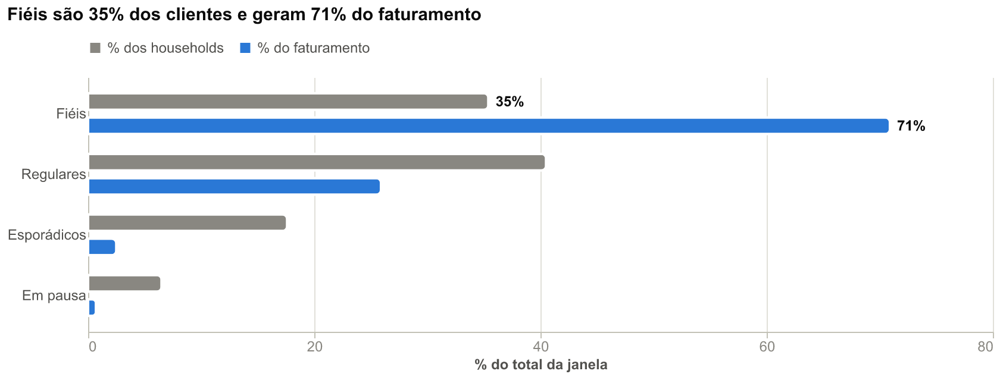
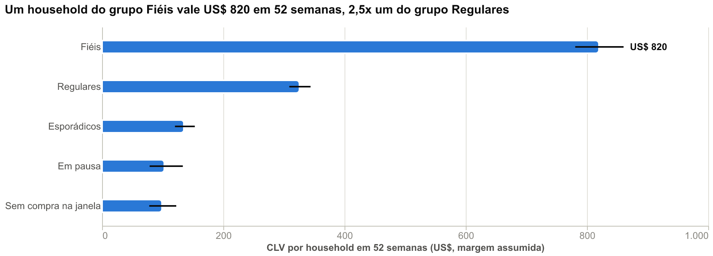
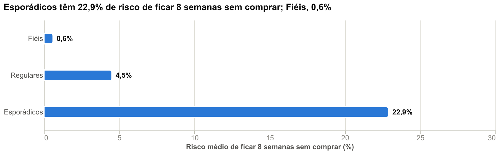
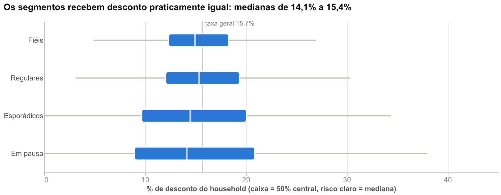
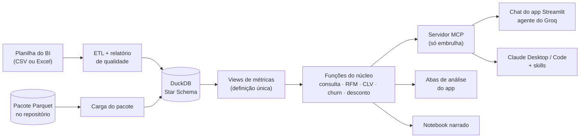
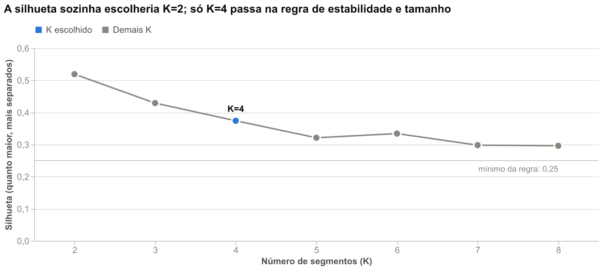
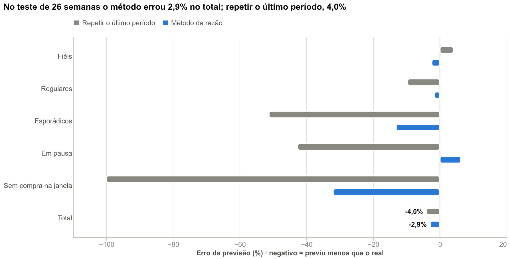
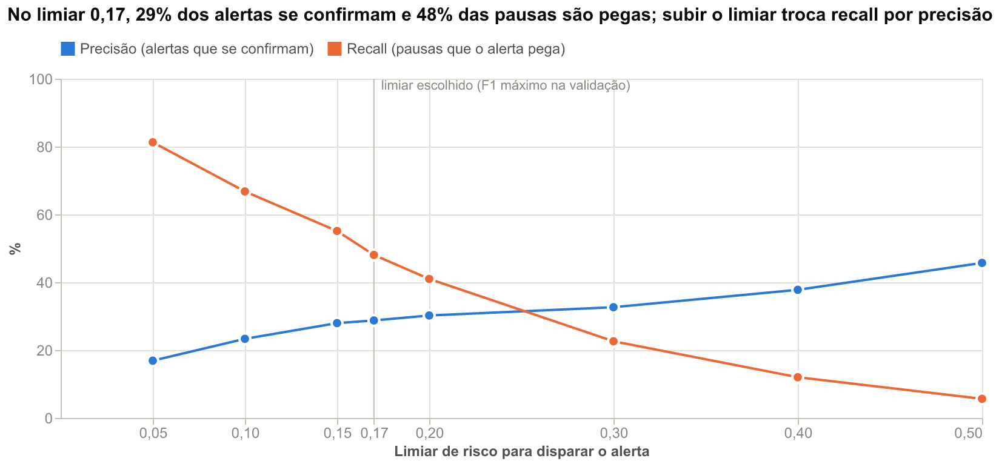
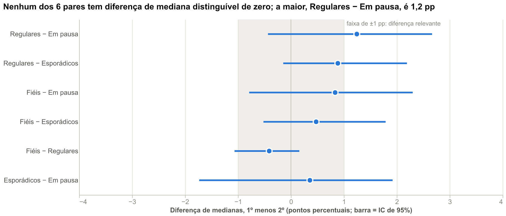

# Assistente Comercial + Análise de Clientes (Dunnhumby)

Ferramenta para a área comercial de varejo. O usuário exporta uma planilha do BI, arrasta para o app e:

- **pergunta em linguagem de negócio** num chat que responde consultando os dados por SQL (o SQL fica visível para conferência);
- **consulta abas de análise estatística de clientes** (segmentação, valor do cliente, risco de pausa, teste de desconto), cada uma abrindo com a conclusão de negócio e a ação recomendada.

Os dados são o dataset público **Dunnhumby "The Complete Journey"** (2.500 households, cerca de dois anos de compras, mais de 500 lojas). O mesmo núcleo de funções atende o app (Streamlit, com um agente do Groq) e o Claude Desktop/Code (por um servidor MCP, com skills).

- **App publicado:** _endereço a preencher depois da publicação (passo a passo na seção 11)._
- **Notebook narrado, com as saídas salvas:** [`notebooks/analise_clientes_dunnhumby.ipynb`](notebooks/analise_clientes_dunnhumby.ipynb)

## Sumário

1. [O problema de negócio](#1-o-problema-de-negócio)
2. [O que o produto faz](#2-o-que-o-produto-faz)
3. [Arquitetura](#3-arquitetura)
4. [Dados](#4-dados)
5. [Limpeza e qualidade](#5-limpeza-e-qualidade)
6. [Definição das métricas](#6-definição-das-métricas)
7. [O chatbot](#7-o-chatbot)
8. [As análises](#8-as-análises)
9. [Guard-rails e testes](#9-guard-rails-e-testes)
10. [Como rodar local](#10-como-rodar-local)
11. [Publicação no Streamlit Community Cloud](#11-publicação-no-streamlit-community-cloud)
12. [Estrutura de pastas](#12-estrutura-de-pastas)
13. [Limitações](#13-limitações)
14. [Implementado e roadmap](#14-implementado-e-roadmap)
15. [Fonte dos dados e termos de uso](#15-fonte-dos-dados-e-termos-de-uso)

---

## 1. O problema de negócio

No varejo, o banco de dados que alimenta o BI costuma ser controlado pelo time de dados. As áreas de negócio (comercial, e-commerce, gerência) não têm permissão para mexer nele, por segurança e para manter a base íntegra.
O dia a dia dessas áreas é exportar planilhas do BI e cruzá-las à mão. Uma pergunta simples ("quanto a loja 367 vendeu de laticínios no último mês, e como isso se compara ao ano passado?") vira um pedido ao BI que volta no dia seguinte.

**A solução:** o usuário exporta a planilha como já faz, arrasta para o app e pergunta em linguagem de negócio. **A carga por arquivo é uma escolha de produto, não uma limitação técnica:** funciona sem acesso ao banco, sem depender do time de dados e sem exigir que o usuário saiba SQL ou programação.

Há dois públicos, com duas ferramentas paralelas:

- **O chat atende consultas pontuais do dia a dia** (comercial, e-commerce, gerência): perguntas que antes viravam pedido ao BI.
- **As abas de análise atendem a decisão** (gerência e diretoria): a base já "mastigada", com quem são os clientes, quanto valem, quem tende a parar de comprar e por quê, e a conclusão antes dos gráficos.

## 2. O que o produto faz

- **Chat (segunda aba, depois do Resumo).** Pergunta em português de negócio, resposta em texto com o número e o contexto. O SQL usado aparece num expander, o glossário de negócio é injetado na pergunta e a barra lateral mostra o consumo de tokens da sessão.
- **Segmentos (RFM).** Quem são os clientes, em quatro segmentos estáveis, com retenção por coorte de apoio.
- **Valor do cliente (CLV).** Quanto cada grupo vale em margem nas próximas 52 semanas, com intervalo de confiança e teste retroativo.
- **Risco de pausa (churn).** Quem tende a ficar 8 semanas sem comprar, contra uma regra simples, com o dinheiro em risco por segmento.
- **Desconto por segmento.** Se os segmentos recebem desconto diferente, medido pelo tamanho do efeito e não só pelo p-valor.
- **Dados e qualidade.** Resumo da carga, relatório de qualidade e reconciliação com o bruto.
- **Carga por upload (CSV ou Excel) ou por pasta `data/`; o upload tem prioridade.** Sem nenhum dos dois, o app usa o pacote de dados em Parquet versionado no repositório (seção 4).

Cada aba de análise abre com o bloco **"e daí?"**: conclusão, ação recomendada, impacto estimado e limitações. Os gráficos vêm depois, e o título de cada um diz a conclusão. Os gráficos abaixo são os mesmos das abas (e do notebook):

| | |
|---|---|
|  |  |
|  |  |

## 3. Arquitetura



- **Funções do núcleo primeiro, MCP depois.** Consulta, segmentação, CLV, churn e teste de desconto são funções Python testadas sem MCP. O servidor MCP (`src/mcp_server.py`) só as registra, com a descrição e os parâmetros vindos do docstring. Se o MCP der problema, o núcleo continua funcionando; o app tem reserva e chama as funções direto.
- **Um servidor, dois clientes.** O mesmo servidor atende o chat do app (agente do Groq via `langchain-mcp-adapters`) e o Claude Desktop/Code (com as skills de `.claude/skills/`). As abas de análise do app chamam o núcleo direto.
- **`docs/spec_ferramentas_mcp.md` é a fonte única das regras das ferramentas.** Skills e prompt do agente são escritos a partir dela, e testes garantem que spec, docstrings, skills e prompt dizem a mesma coisa.
- **Cada métrica é definida uma vez, como view no DuckDB.** Chat, abas e notebook consomem as views. O notebook confere por um segundo caminho, direto na tabela de fatos, e a diferença é zero.
- **Um processo do servidor por sessão do app.** Cada sessão abre o seu servidor MCP preso ao seu banco, então o isolamento é do processo. Ele abre na primeira pergunta, fecha ao recarregar os dados e se encerra sozinho depois de 20 minutos sem uso.
- **Por que o Groq no app público:** o plano gratuito, com função de ferramenta e baixa latência, permite um app público sem custo. A criação do modelo fica isolada em `criar_modelo()`, e a troca de provedor é em um lugar só. A chave nunca está no código: vem de `st.secrets`, da variável `GROQ_API_KEY` ou do campo da barra lateral.

## 4. Dados

**Dataset:** [Dunnhumby "The Complete Journey"](https://www.kaggle.com/datasets/frtgnn/dunnhumby-the-complete-journey): rede de supermercados dos EUA, 2.500 households, cerca de 2 anos, mais de 500 lojas.

| Tabela | Conteúdo | Papel |
|---|---|---|
| `transaction_data` | uma linha por item comprado | base de tudo (obrigatória) |
| `product` | catálogo de produtos | dimensão de produto (obrigatória) |
| `hh_demographic` | demografia (só parte dos households) | opcional |
| `campaign_table`, `campaign_desc`, `coupon`, `coupon_redempt` | campanhas, cupons e resgates | contexto de ações, opcional |
| `causal_data` | produto em display ou mailer por semana e loja | agregado por semana e loja, opcional |

**Janela de análise e base de comparação.** A janela é formada pelas últimas **26 semanas** de `WEEK_NO` que têm 7 dias completos. A base de comparação é o **mesmo período um ano antes** (`WEEK_NO - 52`), alinhada por semana (não por data) para manter a mesma mistura de dias da semana, e só com as **lojas presentes nos dois períodos** (like-for-like). Toda comparação temporal do projeto usa essa regra.

**Particularidades do dataset que o projeto trata:**

- `SALES_VALUE` já é **líquido** (depois de cupom e desconto de fidelidade). Os descontos (`RETAIL_DISC`, `COUPON_DISC`, `COUPON_MATCH_DISC`) vêm negativos e servem para decompor; o valor bruto é o líquido menos os descontos.
- `DAY` é um inteiro relativo, convertido para data com uma data-base arbitrária. **As datas reais são arbitrárias**: feriados e sazonalidade por data não são confiáveis, e por isso se compara por semana alinhada.
- Combustível e pseudo-itens de cupom não são mercadoria e ficam em camada separada, com contagem e reconciliação.
- Só parte dos households tem demografia, então nenhuma análise a usa.
- Não existe vendedor individual: a menor unidade de equipe é a loja.

**De onde o app lê os dados, nesta ordem de prioridade:**

1. **Upload** (CSV ou Excel) na tela de carga. Só `transaction_data` e `product` são obrigatórios; as outras seis tabelas, quando faltam, entram vazias e a carga avisa o que deixa de existir.
2. **Pasta `data/` ou `data/raw/`** com os CSV (o ETL leva cerca de 2 minutos).
3. **Pacote Parquet** em `data/processed/parquet/`, versionado no repositório: a base já limpa, com cerca de 18 MB. A carga a partir do pacote leva em torno de 12 segundos e dá **exatamente os mesmos números** do ETL (um teste compara tabelas, views e as quatro análises, campo a campo).

O pacote guarda o **histórico inteiro, não só as duas janelas**, porque as análises usam mais do que elas: o risco de pausa usa o histórico desde a semana 5, o CLV calibra um ano antes e a coorte depende da primeira compra no histórico. Com só as duas janelas esses números mudariam.
A `versao_base` (hash dos arquivos de origem, dos parâmetros do `config.yaml` e da versão do ETL) vai em todo retorno de ferramenta; se um parâmetro mudar, o pacote fica velho e a carga recusa com a instrução de gerá-lo de novo.

## 5. Limpeza e qualidade

Cada regra de limpeza registra **quantas linhas afetou e por quê**, e o total limpo **reconcilia com o bruto**. Nada de `fillna`/`dropna` em silêncio. Cada linha bruta cai em **uma só regra**, por precedência (valor não numérico, cesta ausente, chave ou data inválida, não-mercadoria, quantidade ≤ 0), e itens grátis (`SALES_VALUE = 0` com `QUANTITY > 0`) ficam, porque são itens reais. O ETL é recusado (o banco não é publicado) se a reconciliação por semana falhar.

<!-- gerado:QUALIDADE -->
- **2.595.732** linhas brutas = **2.548.662** vendas limpas + **47.070** ajustes (não-mercadoria e quantidade ≤ 0, guardados à parte). Valor: US$ 8.057.463 = US$ 7.376.322 + US$ 681.141.
- **Reconciliação por semana:** 102 semanas conferidas, 0 divergentes (maior diferença: US$ 0,00; tolerância US$ 0,01).
- **Nulos:** 0 em todas as colunas. **Duplicados:** 0. **Junções que multiplicam linhas:** 0.
- **Ruído de ponto flutuante** no arquivo: 29 linhas de `SALES_VALUE` e 34 de `RETAIL_DISC` (valores como `5,55E-17`); por isso os valores monetários são lidos com 4 casas decimais.

| Regra | O que filtra | Linhas atribuídas | Valor (US$) |
|---|---|---|---|
| `valor_nao_numerico` | QUANTITY ou SALES_VALUE ausente ou não numérico | 0 | 0 |
| `cesta_ausente` | BASKET_ID ausente | 0 | 0 |
| `chave_ou_data_invalida` | DAY, WEEK_NO, household, loja ou produto ausente/inválido | 0 | 0 |
| `nao_mercadoria` | Combustível, transações diversas e pseudo-itens de cupom | 32.805 | 681.122 |
| `quantidade_nao_positiva` | QUANTITY menor ou igual a zero | 14.265 | 19 |
<!-- /gerado:QUALIDADE -->

Antes de cada JOIN e depois dele as linhas são contadas, e o relatório completo está em [`relatorios/qualidade.md`](relatorios/qualidade.md).

## 6. Definição das métricas

Cada métrica é definida **uma vez**, como view no DuckDB, e a definição de negócio fica na tabela `metricas_definicao`. O prompt do agente, o glossário, as abas e o notebook consomem essas views.

<!-- gerado:METRICAS -->
| Métrica | Definição de negócio | Fórmula | View de origem |
|---|---|---|---|
| `faturamento` | Valor líquido vendido, já depois de cupom e desconto de fidelidade (SALES_VALUE). | `SUM(faturamento)` | `vw_vendas_item` |
| `desconto_total` | Dólares concedidos em desconto: loja/fidelidade + cupom + cupom casado. Positivo. | `SUM(desconto_total) = -SUM(RETAIL_DISC + COUPON_DISC + COUPON_MATCH_DISC)` | `vw_vendas_item` |
| `desconto_loja` | Parte do desconto dada pela loja (cartão de fidelidade), RETAIL_DISC. | `SUM(desconto_loja)` | `vw_vendas_item` |
| `desconto_cupom` | Parte do desconto vinda de cupom: COUPON_DISC + COUPON_MATCH_DISC. | `SUM(desconto_cupom)` | `vw_vendas_item` |
| `valor_bruto` | Valor antes dos descontos: faturamento + desconto total. | `SUM(valor_bruto) = SUM(faturamento) + SUM(desconto_total)` | `vw_vendas_item` |
| `pct_desconto` | Desconto como % do valor bruto (0-100). | `100 * SUM(desconto_total) / SUM(valor_bruto)` | `vw_metricas_loja_semana` |
| `cestas` | Número de idas à loja com compra: cestas distintas (BASKET_ID). | `COUNT(DISTINCT BASKET_ID)` | `vw_metricas_cesta` |
| `itens` | Unidades vendidas (QUANTITY). | `SUM(quantidade)` | `vw_vendas_item` |
| `ticket_medio` | Quanto cada cesta fatura em média. | `SUM(faturamento) / COUNT(DISTINCT BASKET_ID)` | `vw_metricas_loja_semana` |
| `itens_por_cesta` | Unidades por cesta. | `SUM(quantidade) / COUNT(DISTINCT BASKET_ID)` | `vw_metricas_loja_semana` |
| `clientes` | Households distintos que compraram. Não soma entre semanas, lojas ou categorias. | `COUNT(DISTINCT household_key)` | `vw_metricas_cesta` |
| `idas_por_cliente` | Frequência: cestas por cliente no período. | `COUNT(DISTINCT BASKET_ID) / COUNT(DISTINCT household_key)` | `vw_yoy_resumo` |
| `cliente_ativo` | Household com pelo menos uma compra nas últimas N semanas do período (N = 8). | `coluna cliente_ativo (booleana): última compra dentro das últimas 8 semanas do período` | `vw_metricas_cliente` |
| `recencia_dias` | Dias entre a última compra do household e o último dia do período. | `coluna recencia_dias = dias entre a última compra e o último dia do período` | `vw_metricas_cliente` |
| `semanas_com_compra` | Número de semanas (WEEK_NO) em que o household comprou, em todo o histórico. | `COUNT(*) de vw_cliente_semana por household_key` | `vw_cliente_semana` |
| `frequencia_cliente` | Número de cestas do household no período. | `COUNT(DISTINCT BASKET_ID)` | `vw_metricas_cliente` |
| `valor_cliente` | Faturamento do household no período. | `SUM(faturamento)` | `vw_metricas_cliente` |
| `janela_atual` | As últimas 26 semanas completas de WEEK_NO (termina na última semana com 7 dias). | `semana_ini_atual .. semana_fim_atual` | `vw_janela` |
| `base_ano_anterior` | As mesmas semanas um ano antes (WEEK_NO - 52), alinhadas por semana. | `semana_ini_base .. semana_fim_base` | `vw_janela` |
| `semana_alinhada` | Semana da janela atual a que cada semana da base corresponde (base + 52). | `WEEK_NO (atual) ou WEEK_NO + 52 (base)` | `vw_vendas_item` |
| `like_for_like` | Comparação só entre lojas com pelo menos uma cesta nos dois períodos. | `STORE_ID presente em atual e base` | `vw_lojas_like_for_like` |
| `variacao_ano_anterior` | Variação % da janela atual contra a base, nas lojas like-for-like. | `100 * (atual / base - 1)` | `vw_yoy_resumo` |
| `arvore_de_vendas` | Faturamento = clientes x idas por cliente x ticket médio; cada fator tem variação própria. | `(1 + var_clientes_pct/100) * (1 + var_idas_por_cliente_pct/100) * (1 + var_ticket_pct/100) = 1 + var_faturamento_pct/100` | `vw_yoy_resumo` |
| `penetracao` | % dos clientes (que compraram algo no período) que compraram a categoria. | `colunas penetracao_atual e penetracao_base = 100 * clientes_atual (ou clientes_base) / clientes com qualquer compra no período` | `vw_yoy_categoria` |
| `marca_propria` | Produtos com BRAND = 'Private'; os demais são 'National'. | `BRAND = 'Private'` | `vw_yoy_categoria` |
| `ultimo_mes` | As últimas 4 semanas completas da janela (relativas ao fim dos dados, não a hoje). | `semana_ini_ultimo_mes .. semana_fim_atual` | `vw_janela` |
| `ultimo_trimestre` | As últimas 13 semanas completas da janela. | `semana_ini_ultimo_trimestre .. semana_fim_atual` | `vw_janela` |
| `amostra_pequena` | Loja com menos cestas na janela do que o mínimo configurado: números instáveis. | `coluna amostra_pequena = total de cestas da loja no período < 100` | `vw_metricas_loja_semana` |
<!-- /gerado:METRICAS -->

## 7. O chatbot

**Como funciona.** A pergunta passa por três etapas antes e durante a resposta:

1. **Glossário de negócio (RAG).** Uma busca por TF-IDF de n-gramas, mais um bônus quando o termo ou um sinônimo aparece na pergunta, traz as definições relevantes ("último mês", "like-for-like", "penetração", "cliente ativo") e as injeta junto da pergunta. É determinístico e não é uma ferramenta. A busca usa scikit-learn, sem modelos de embedding, para o app caber na memória do plano gratuito.
2. **Agente com ferramentas.** O modelo recebe um catálogo compacto das views e decide entre `executar_consulta` (pergunta pontual em SQL) e as ferramentas de análise (`segmentar_clientes`, `calcular_clv`, `prever_churn`, `testar_desconto_entre_segmentos`). A resposta começa pela conclusão, com o número e o contexto.
3. **Transparência.** O SQL executado fica num expander, o resultado em tabela, e a barra lateral mostra os tokens da última resposta e da sessão.

**Exemplos de perguntas** (do conjunto de avaliação):

- Qual foi o faturamento total na janela atual? E o ticket médio?
- Quanto a loja 367 vendeu de laticínios no último mês?
- Qual loja teve o maior ticket médio nas últimas 4 semanas?
- A venda da loja 367 caiu contra o ano passado por menos clientes, menos idas à loja ou menos gasto por ida?
- Quanto a marca própria cresceu em laticínios contra o mesmo período do ano passado?
- Quantos households resgataram cupom da campanha 18 e quanto gastaram durante o período da campanha?
- Quanto vale, em margem esperada, um household do grupo Fiéis? Os segmentos recebem desconto diferente?

**Orçamento de tokens.** O plano gratuito do Groq limita os tokens por minuto. Medido: cerca de 2 mil tokens fixos por chamada ao modelo e cerca de 4,6 mil por pergunta com uma consulta, ou seja, algumas perguntas por minuto. Por isso `descrever_dados` devolve por padrão uma lista curta (cerca de 2 mil tokens, contra 6 mil do catálogo completo) e entrega o detalhe de uma view ou métrica sob pedido (`detalhe=`).

**Avaliação.** O conjunto tem 34 perguntas e 40 cargas de ataque:

- 20 perguntas de negócio com o SQL esperado escrito à mão;
- 8 perguntas de análise, cujo valor esperado é lido da própria ferramenta (e conferido por SQL e pandas nos testes);
- 6 maliciosas: apagar tabela, injeção de comando no texto da pergunta, pedir a base inteira, ler o `.env`, perguntar por um vendedor que não existe e várias instruções numa só;
- 40 cargas de ataque em SQL (escrita, DDL, várias instruções, disfarces de caixa e comentário, leitura de arquivo, configuração, tabelas internas, base inteira) e quatro consultas legítimas com cara de ataque, que precisam passar.

<!-- gerado:AVALIACAO -->
**Oráculo (sem modelo de linguagem)**: o SQL esperado de cada pergunta, escrito à mão, e o valor de cada ferramenta de análise, conferidos contra faixas de sanidade. Valida o conjunto de perguntas, não o modelo.

- Data: 2026-10-06 19:21 · base `ddb4d8032cc2`
- Valor esperado resolvido e dentro da faixa de sanidade: **100%** de 28 (20 de negócio com SQL esperado, 8 de análise com o valor da ferramenta)
- Glossário traz os termos esperados entre os 4 primeiros: **100%**

**Bloqueio (sem modelo de linguagem)**: o SQL de cada pergunta maliciosa e 40 cargas de ataque passam pelo servidor MCP, o caminho real do agente.

- Data: 2026-10-06 19:21 · base `ddb4d8032cc2`
- Cargas de ataque bloqueadas ou limitadas: **100%** de 46 (meta: 100%)
- Consultas legítimas bloqueadas por engano: **0** de 4
- Integridade das tabelas depois dos ataques: **ok, mesmas linhas**

**Ao vivo (com o modelo do Groq)**: **ainda não medido.** Depende de uma chave do Groq no terminal de quem roda (`set GROQ_API_KEY=...` e `venv\Scripts\python.exe -m eval.rodar_avaliacao --modo vivo`). Até lá, o README não afirma taxa de acerto do modelo.
<!-- /gerado:AVALIACAO -->

A avaliação roda em três modos (`--modo oraculo`, `--modo bloqueio`, `--modo vivo`) e deve ser repetida sempre que o prompt, o glossário, as views, as descrições das ferramentas ou as skills mudarem.

## 8. As análises

As quatro análises formam uma narrativa só, nesta ordem: **quem são** os clientes, **quanto valem**, **o que vai acontecer** com cada grupo e **por que diferem**. O notebook [`notebooks/analise_clientes_dunnhumby.ipynb`](notebooks/analise_clientes_dunnhumby.ipynb) traz o raciocínio completo; abaixo, o resumo de cada uma. O bloco "e daí?" de cada seção é o texto devolvido pela própria ferramenta, atualizado por script.

### 8.1 RFM + K-Means: quem são os clientes

**Pergunta de negócio:** quais clientes merecem tratamento diferente (fidelizar, reativar, deixar em paz)?

**Método e escolhas estatísticas.**

- **Variáveis:** recência (dias), frequência (cestas) e valor (faturamento líquido), com frequência e valor em `log1p` (cauda longa) e tudo padronizado. O SQL é ordenado por `household_key`, porque o K-Means depende da ordem das linhas.
- **K por uma regra escrita antes de rodar** (`analises.rfm` no `config.yaml`): K ≥ 3; estabilidade (ARI ≥ 0,90 entre sementes e entre subamostras); nenhum segmento abaixo de 5%; silhueta ≥ 0,25; vence a maior silhueta. A silhueta sozinha escolheria K=2, que só separa quem comprou há pouco de quem não comprou, o que a recência já diz.
- **Nomes vindos do perfil real** de cada grupo, nunca de uma lista fixa por ordem de cluster. Households sem compra na janela ficam fora e são contados.
- **Coorte de retenção como apoio**, não como pilar: entrada no painel não é cliente novo.

<!-- gerado:ANALISE_RFM -->
> **E daí?**
>
> **Conclusão.** Fiéis são 35% dos households e fazem 71% do faturamento da janela; 4 segmentos, com estabilidade mínima de 0,97 (ARI).
>
> **Ação recomendada.** Fiéis: proteger com benefícios de fidelidade e acompanhar qualquer queda de frequência; Regulares: aumentar frequência e gasto por ida (ofertas cruzadas entre categorias); Esporádicos: reativar com ofertas de retorno antes que entrem em pausa longa.
>
> **Impacto estimado.** Fiéis geram US$ 1.525.211 por janela de 26 semanas; perder 5% deles custa cerca de US$ 76.261. Os Em pausa (158 households) geram hoje US$ 15.592 (0,7%) da janela; a aba de CLV mostra quanto voltam a valer.
>
> **Limitações.** Painel de 2.500 households frequentes, não o cliente médio do varejista; os segmentos descrevem as últimas 26 semanas e mudam com a janela. 79 households sem compra na janela ficam fora da segmentação (pausa total; entram no CLV como grupo próprio) e não aparecem como segmento. Silhueta de 0,37: estrutura moderada, as fronteiras entre segmentos são graduais. O K vem da regra combinada (silhueta, estabilidade, tamanho), não só da silhueta, que sozinha escolheria K=2. Segmento descreve comportamento, não causa.
<!-- /gerado:ANALISE_RFM -->



### 8.2 CLV: quanto vale cada grupo

**Pergunta de negócio:** quanto vale investir em cada grupo (fidelização, reativação)?

**Método e escolhas.**

- **CLV = margem × gasto médio das últimas 26 semanas × razão futuro/passado** do mesmo segmento um ano antes (o gasto nas 52 semanas seguintes dividido pelo das 26 anteriores). Multiplicar o passado por dois seria ingênuo por causa da regressão à média.
- **Margem (25%) e horizonte (52 semanas) são premissas explícitas**, não dado: o dataset não tem custo, e o CLV escala linearmente com a margem.
- Households **sem compra na janela** formam um grupo próprio, estimado pelo que os households análogos gastaram depois, um ano antes.
- **Intervalo de confiança de 95% por bootstrap de households**; ele não cobre a incerteza da margem nem a escolha dos segmentos.
- **Backtest de 26 semanas** contra uma regra ingênua. O horizonte de 52 semanas não tem backtest, e o CLV vale como média de grupo, não como previsão por cliente.

<!-- gerado:ANALISE_CLV -->
> **E daí?**
>
> **Conclusão.** Fiéis valem US$ 820 por household em 52 semanas (IC 95%: US$ 781 a US$ 860) e concentram 64% do valor esperado (US$ 1.103.220 de margem).
>
> **Ação recomendada.** Priorizar a retenção dos Fiéis: cada 1% de gasto perdido neles pesa mais que em qualquer outro grupo. Esporádicos e Em pausa tendem a gastar mais nas semanas seguintes do que no ritmo atual (ritmo de 2,1x): prefira ofertas de reativação seletivas a descontos amplos.
>
> **Impacto estimado.** Valor esperado total em 52 semanas: US$ 1.103.220 de margem (IC 95%: US$ 1.063.210 a US$ 1.143.641) sobre US$ 4.412.881 de receita, com margem assumida de 25%. Uma queda de 5% no gasto dos Fiéis custa cerca de US$ 35.126.
>
> **Limitações.** A margem de 25% é premissa (o dataset não tem custo): o CLV escala linearmente com ela. O horizonte de 52 semanas não pode ser testado: só há uma transição de 52 semanas observada, e ela pode não se repetir. No backtest de 26 semanas o método errou 2,9% no total (regra ingênua: 4,0%) e ganhou em 5 de 5 grupos; por household o erro absoluto médio foi US$ 321 contra US$ 317 da regra ingênua: o valor serve como média de grupo, não como previsão individual. O intervalo cobre só a variação entre households; não inclui a incerteza da margem nem a escolha dos segmentos. Razões altas nos grupos de menor gasto refletem em parte regressão à média (parte do gasto baixo de uma janela é acaso de calendário), sem desconto financeiro em 12 meses.
<!-- /gerado:ANALISE_CLV -->



### 8.3 Risco de pausa ("churn"): quem vai parar de comprar

**Pergunta de negócio:** quem abordar com reativação e quem deixar em paz?

**Método e escolhas.**

- **Definição explícita:** churn aqui é **pausa longa, 8 semanas sem comprar** (o mesmo limite de "cliente ativo" e de "Em pausa"). A maioria de quem pausa volta, então o texto fala em pausa e a ação é priorizar contato, não "salvar clientes perdidos".
- **Split temporal, nunca sorteio de linhas:** o modelo treina em fotos antigas, o limiar é escolhido numa foto seguinte e a avaliação usa duas fotos recentes, com janelas de rótulo que não se sobrepõem (o código recusa um plano que se sobreponha).
- **Cinco variáveis interpretáveis** numa regressão logística padronizada, com o sinal de cada coeficiente conferido contra a intuição de negócio. Com dez variáveis a colinearidade gerava um sinal contrário ao esperado, sem ganho de AUC.
- **Contra uma regra simples** ("sem compra há k semanas"), reportando AUC, AUC-PR, precisão, recall, matriz de confusão e calibração; intervalo de confiança da diferença de AUC por bootstrap de households. Se o modelo não ganhasse, o achado seria esse.

<!-- gerado:ANALISE_CHURN -->
> **E daí?**
>
> **Conclusão.** Cerca de 136 dos 2.203 households ativos devem passar 8 semanas sem comprar; Esporádicos concentram 64% dessas pausas (risco médio de 22,9%, contra 0,6% dos Fiéis). O modelo ordena melhor que a regra de recência (AUC 0,85 contra 0,74).
>
> **Ação recomendada.** Fazer reativação seletiva nos 243 households em alerta hoje (limiar 0,17): as pausas se concentram nos Esporádicos, mas o dinheiro em risco está nos Regulares (56% do valor em risco). Cada alerta acerta 29% das vezes e o conjunto pega 48% das pausas. Não gastar com Fiéis (risco de 0,6%).
>
> **Impacto estimado.** Faturamento em risco nas próximas 8 semanas ≈ US$ 12.706, calculado como risco x gasto semanal x 8, ou 1,9% do faturamento esperado do período. Como 80% de quem pausa volta em até 18 semanas, a perda efetiva tende a ser menor.
>
> **Limitações.** Pausa não é saída: 80% voltam em 18 semanas, então o nome "churn" vale como pausa longa de 8 semanas. A população é quem comprou nas últimas 8 semanas e tem ao menos 16 semanas de histórico; 297 households já estão em pausa e ficam fora da previsão. Precisão modesta: de cada 100 alertas, 29 se confirmam. O modelo usa só comportamento de compra e mostra associação, não causa. O treino repete households em várias fotos (o intervalo é por household no teste). Os segmentos mudam com a janela.
<!-- /gerado:ANALISE_CHURN -->



### 8.4 Teste de hipótese: o desconto muda de segmento para segmento?

**Pergunta de negócio:** a política de desconto deve variar por segmento?

**Método e escolhas.**

- **Hipótese escrita antes de rodar:** os segmentos recebem desconto parecido.
- **Kruskal-Wallis** (o teste de Shapiro-Wilk rejeita a normalidade), e **post-hoc de Mann-Whitney com correção de Holm só se o teste geral for significativo**.
- **Significância não basta com mais de 2.400 households.** O veredito exige também tamanho de efeito (eta²) e a diferença de medianas com intervalo de confiança por bootstrap, por uma regra escrita antes: relevante se eta² ≥ 1% ou algum par com diferença ≥ 1 ponto percentual e IC fora de zero.
- **Sensibilidade:** o teste é repetido só com households de 5 ou mais compras, porque o percentual de quem comprou pouco é ruído de poucas cestas.
- Diferença entre grupos **não é efeito causal** do desconto.

<!-- gerado:ANALISE_DESCONTO -->
> **E daí?**
>
> **Conclusão.** Os segmentos recebem desconto praticamente igual: as medianas vão de 14,1% (Em pausa) a 15,4% (Regulares), 1,2 ponto percentual de amplitude. O teste geral acusa diferença (p = 0,009), mas o efeito é desprezível: eta² = 0,0036, ou 0,4% da variação, e todos os intervalos das diferenças de mediana ficam abaixo de 1 ponto ou incluem zero. Só com households de 5 ou mais compras (2.138) a significância desaparece (p = 0,523, eta² = 0,0000): a diferença do teste completo vem do ruído de medir desconto em poucas compras.
>
> **Ação recomendada.** Tratar o desconto como política geral, não por segmento: a diferença estatística existe só no papel e não justifica ajustar taxa para nenhum grupo. Para mexer na margem, olhar o desconto como um todo ou por categoria (não testado aqui).
>
> **Impacto estimado.** Desconto total da janela: US$ 399.892 (15,7% do valor bruto). Se todos os segmentos tivessem a menor taxa ponderada (Fiéis, 15,45%), o desconto cairia US$ 5.607 (1,4% do total), supondo que a demanda não mudasse.
>
> **Limitações.** Diferença entre grupos, não efeito causal do desconto: o teste não diz que desconto traz mais compra. Os segmentos são definidos por recência, frequência e valor, e o % de desconto de quem comprou pouco é instável (poucas cestas), o que aumenta a dispersão dos grupos Esporádicos e Em pausa; por isso a repetição com 5 ou mais compras (nela os Em pausa ficam com 45 households). Uma só janela de 26 semanas. Desconto de loja (cartão) e de cupom estão somados. Os p-valores dos pares são ajustados por Holm; os intervalos de confiança das diferenças não. Household não é pessoa. Households sem compra na janela ficam fora.
<!-- /gerado:ANALISE_DESCONTO -->



## 9. Guard-rails e testes

**As regras são impostas no código, nunca só em texto**, e cada uma tem teste:

- **Só leitura.** O motor abre o banco como `read_only`, sem acesso a arquivos, com a configuração travada e a memória limitada. Escrita, DDL, `ATTACH`, `COPY`, `PRAGMA` e `INSTALL` são recusados.
- **Só `SELECT`/`WITH`, uma instrução por chamada.** A validação usa o parser do DuckDB (`json_serialize_sql`), não expressão regular: o tipo da instrução não basta (`PRAGMA version` aparece como `SELECT`). Comentários e variações de caixa não enganam.
- **Só as fontes permitidas.** Tabelas por lista de permissão (`vw_*`, dimensões, fato de vendas, campanhas e cupons), com o escopo correto de CTE; funções de tabela e leitura de arquivo são bloqueadas.
- **Limites.** 20 linhas por padrão e no máximo 200, 60 KB por retorno e 30 s por consulta.
- **Retorno enxuto e rastreável.** Nenhuma ferramenta devolve a lista de households; todo retorno traz `versao_base` e a janela usada; todo erro é `{erro, sugestao}`, sem stack trace.
- **Log de toda chamada** (ferramenta, parâmetros, tempo, linhas, tamanho, erro).
- **Sessões isoladas.** Cada sessão do app tem o seu banco e o seu servidor MCP.
- **Segredos.** A chave do Groq nunca está no código; `.env` e `.streamlit/secrets.toml` estão no `.gitignore`.

**Testes.** São mais de 650 testes automatizados (pytest), com dados sintéticos de resultado conhecido e conferências da base real contra caminhos independentes (CSV, SQL e pandas). Cobrem guard-rails, formato de cada ferramenta, métricas, as quatro análises, o app (AppTest), o servidor MCP (sobe como subprocesso), a avaliação, o pacote Parquet, o notebook (executa do zero e reproduz as saídas) e este README (os blocos gerados não podem envelhecer). Numa máquina com pouca memória, rode por partes; a receita está no `CLAUDE.md`.

## 10. Como rodar local

**Requisitos:** Python 3.13 ou superior (desenvolvido em 3.14) e cerca de 2 GB livres.

```bash
# 1. ambiente e dependências (versões travadas)
python -m venv venv
venv\Scripts\python.exe -m pip install -r requirements.txt          # só o app e o servidor MCP
venv\Scripts\python.exe -m pip install -r requirements-dev.txt      # + testes, notebook e avaliação

# 2. dados: não precisa baixar nada; sem CSV, o app usa o pacote Parquet do repositório.
#    Para refazer a base a partir dos CSV originais (credencial do Kaggle no ambiente, nunca no código):
venv\Scripts\python.exe baixar_dados.py        # baixa data/raw/
venv\Scripts\python.exe -m src.etl             # ETL (~2 min): banco + relatório de qualidade
venv\Scripts\python.exe -m src.pacote exportar # regenera o pacote Parquet (só se a base ou os parâmetros mudarem)

# 3. app (a chave do Groq é opcional aqui: pode ser digitada no campo da barra lateral)
venv\Scripts\python.exe -m streamlit run app/app.py
```

**Outros comandos:**

```bash
venv\Scripts\python.exe -m pytest tests -q                         # testes (em partes, veja o CLAUDE.md)
venv\Scripts\python.exe -m eval.rodar_avaliacao --modo oraculo     # avaliação sem modelo de linguagem
venv\Scripts\python.exe -m eval.rodar_avaliacao --modo bloqueio    # perguntas maliciosas e ataques pelo MCP
set GROQ_API_KEY=...                                               # no seu terminal; nunca em arquivo versionado
venv\Scripts\python.exe -m eval.rodar_avaliacao --modo vivo        # com o modelo: acerto, ferramenta certa, tokens, tempo
venv\Scripts\python.exe notebooks\construir_notebook.py            # reexecuta o notebook e salva com as saídas
venv\Scripts\python.exe -m src.documentacao                        # atualiza os blocos gerados deste README
```

**Usar o servidor MCP no Claude Desktop ou no Claude Code.** O servidor fala por stdio e, sem `ASSISTENTE_BANCO`, usa o banco do ETL ou, se não houver, constrói o banco a partir do pacote Parquet na primeira vez (cerca de 12 s). Exemplo de configuração do Claude Desktop (`claude_desktop_config.json`); o `cwd` precisa ser a raiz do projeto:

```json
{
  "mcpServers": {
    "assistente-comercial": {
      "command": "C:\\caminho\\do\\projeto\\venv\\Scripts\\python.exe",
      "args": ["-m", "src.mcp_server"],
      "cwd": "C:\\caminho\\do\\projeto"
    }
  }
}
```

As skills em `.claude/skills/` (`consultas-sql`, `analise-estatistica`, `qualidade-validacao`) ensinam o Claude a escolher a ferramenta certa e a interpretar os retornos.

## 11. Publicação no Streamlit Community Cloud

O repositório já traz o necessário: `app/app.py`, `requirements.txt` (só o que o app precisa, com versões travadas), `.streamlit/config.toml` e o pacote de dados em `data/processed/parquet/` (cerca de 18 MB, bem abaixo do limite de 100 MB por arquivo do GitHub).

1. **Publique o repositório no GitHub** (público, para o plano gratuito do Streamlit), com `data/processed/parquet/` incluído. Os CSV originais e os bancos `.duckdb` não sobem (estão no `.gitignore`).
2. Em [share.streamlit.io](https://share.streamlit.io), **New app**, escolha o repositório, o branch e o arquivo principal **`app/app.py`**.
3. Em **Advanced settings**, escolha **Python 3.13** (as versões travadas foram conferidas para Linux em 3.12 e 3.13).
4. **Secrets (opcional):** cole `GROQ_API_KEY = "..."` (modelo em `.streamlit/secrets.toml.example`). Sem isso, cada pessoa digita a própria chave no campo da barra lateral.
5. Publique e coloque o endereço no topo deste README.

**Comportamento esperado.** A primeira abertura de uma sessão fria carrega o pacote (cerca de 12 s) e calcula as quatro análises; medido localmente, cerca de 49 s no total, e depois fica em cache. Cada sessão que usa o chat abre um processo do servidor MCP (cerca de 240 MB, fechado após 20 minutos sem uso).

**Atenção à memória.** O plano gratuito tem cerca de 1 GB. Medido localmente (Windows), uma sessão usa cerca de 350 MB no app e mais cerca de 240 MB com o chat aberto; **poucas sessões de chat simultâneas cabem**. A medição é indicativa, porque a nuvem é Linux. Se o app reiniciar por falta de memória, a saída é reduzir as sessões simultâneas ou usar um plano com mais memória.

## 12. Estrutura de pastas

<!-- gerado:ESTRUTURA -->
```
.claude/skills/           skills do Claude Desktop/Code: `consultas-sql`, `analise-estatistica`, `qualidade-validacao`
app/                      app Streamlit (`app.py`): chat e abas de análise
data/processed/parquet/   pacote de dados em Parquet (a base limpa, ~18 MB) que o app publicado carrega
docs/                     guia do projeto, rotina de trabalho e a spec das ferramentas MCP (`spec_ferramentas_mcp.md`, fonte única das regras)
eval/                     perguntas de negócio, de análise e maliciosas, cargas de ataque e o script de avaliação
notebooks/                notebook narrado (com as saídas salvas), seu construtor, o texto-fonte e os PNG dos gráficos
referencia/               módulos genéricos de apoio (glossário RAG, contador de tokens, testes de hipótese)
relatorios/               auditoria da base e relatório de qualidade gerado pelo ETL
src/                      núcleo: ETL, views de métricas, análises (`nucleo/`), guard-rails, agente, glossário, servidor MCP, cliente MCP e gráficos (`ui/`)
tests/                    testes automatizados (guard-rails, formato das ferramentas, métricas, análises, app, MCP, notebook, README)
.streamlit/               configuração do Streamlit e modelo de segredos (`secrets.toml.example`)
baixar_dados.py           baixa os CSV do Kaggle para `data/raw/`
config.yaml               janela, semente e parâmetros de todas as análises
gerar_requirements.py     gera `requirements.txt` (app) e `requirements-dev.txt` (testes, notebook)
CLAUDE.md                 memória do projeto: comandos e decisões registradas
```
<!-- /gerado:ESTRUTURA -->

## 13. Limitações

**Do dataset**

- **Painel pequeno e frequente.** São 2.500 households que compram com regularidade, não o cliente médio do varejista. Resultados por loja ou por categoria pequena são instáveis (lojas com menos de 100 cestas na janela vêm marcadas como `amostra_pequena`).
- **Datas reais arbitrárias.** `DAY` é relativo; sazonalidade por data e feriados não são medidos.
- **Só parte dos households tem demografia**, então nenhuma análise a usa.
- **Não há devolução registrada, nem custo, nem vendedor.** A margem do CLV é uma premissa, e a menor unidade de equipe é a loja.
- **Período histórico:** o dataset é anterior ao varejo atual, e a "janela recente" é uma simulação sobre `WEEK_NO`.

**Da abordagem**

- **Nada é causal.** Segmentos descrevem comportamento, os fatores do modelo de pausa são associação e a diferença de desconto entre grupos não mede o efeito do desconto sobre a compra.
- **Uma só janela de 26 semanas** e um só ano de comparação.
- **O horizonte de 52 semanas do CLV não tem backtest**, e o CLV não serve como previsão por cliente.
- **A precisão por alerta do risco de pausa é modesta:** o modelo ordena bem os clientes (AUC), mas a maioria dos alertas não se confirma. Serve para priorizar, não para decidir sozinho.
- **Desconto de loja (cartão) e de cupom estão somados** nas análises.
- **Modelo de linguagem:** o chat depende de um modelo gratuito com limite de tokens por minuto; a taxa de acerto do modelo é medida pelo modo vivo da avaliação (seção 7), não pelo oráculo.
- **Memória do plano gratuito** limita as sessões simultâneas de chat (seção 11).

## 14. Implementado e roadmap

| Item | Estado |
|---|---|
| ETL com limpeza documentada, reconciliação e relatório de qualidade | implementado |
| Views de métricas com definição única e comparação com o ano anterior (like-for-like) | implementado |
| Chat com glossário, SQL visível, contador de tokens e carga por upload, pasta ou pacote | implementado |
| Segmentação RFM com K-Means, estabilidade e coorte de apoio | implementado |
| CLV por segmento com intervalo de confiança e backtest | implementado |
| Risco de pausa com validação temporal e regra simples de comparação | implementado |
| Teste de desconto entre segmentos com tamanho de efeito e sensibilidade | implementado |
| Servidor MCP, agente do app via MCP e skills | implementado |
| Avaliação com perguntas maliciosas e cargas de ataque | implementado |
| Notebook narrado com as saídas salvas | implementado |
| Taxa de acerto do modelo no chat (modo vivo) | depende de uma chave do Groq: ver seção 7 |
| Desconto de loja separado do de cupom, por segmento | roadmap |
| Análises em outras janelas, para checar a estabilidade dos segmentos e do risco | roadmap |
| Margem real por categoria no CLV, se o varejista a fornecer | roadmap |
| *Market Basket* (regras de associação entre produtos) | roadmap, como análise à parte |

## 15. Fonte dos dados e termos de uso

Os dados são do dataset **"The Complete Journey", da dunnhumby**, publicado no Kaggle (`frtgnn/dunnhumby-the-complete-journey`). Os CSV originais **não** estão neste repositório (`data/raw/` é ignorado pelo Git); o repositório traz o **pacote Parquet derivado**, com a base já limpa, para o app publicado funcionar.
Consulte os termos de uso do dataset na página do Kaggle antes de redistribuir ou usar comercialmente os dados ou o pacote derivado.
